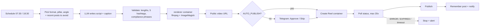

# System design

Two containers:

- **n8n** (stock image, pinned) — schedule, script request, publish calls,
  memory of past posts, failure alerts. All outbound.
- **renderer** — ffmpeg, ImageMagick, fonts and the scripts in `scripts/`
  behind `POST /render`. Reachable only from n8n.

| Format | How it is made |
|---|---|
| Narrated Reel | ElevenLabs voice with word timings → 3–8 shuffled Pexels portrait clips, a cut every ~4–5s → opening hook + word-timed captions burned in → optional music bed |
| Quote card | Text sized to its length, laid out inside the Reels safe zone on a branded gradient → slow zoom → audio track |

Output: MP4, H.264 + AAC, 1080×1920, 30 fps, `faststart` — inside Instagram's
published Reels limits (≤ 1920 px wide, 23–60 fps, 3 s–15 min, ≤ 300 MB).

## Running cost (approx., AUD/month)

| Item | Cost |
|---|---|
| n8n + renderer, self-hosted | free, or ~$6–9 for a small VPS |
| Script writing | ~$1–4 |
| ElevenLabs | from ~$8; check your quota against your posting rate |
| Pexels, Cloudinary free tier, Telegram | free |

## Rules the engine enforces

- Publishing only through the official Instagram API, to an account you own.
- At most 5 hashtags and 2,200 characters per caption.
- Education and motivation, not financial advice: a phrase blocklist stops a
  post before it renders, and investing posts carry a disclaimer.
- `docs/AUDIT.md` records what was found and fixed when the system was first
  actually run.
