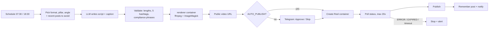

# System design

Two containers:

- **n8n** (stock image, pinned) — schedule, script request, publish calls,
  memory of past posts, failure alerts. All outbound.
- **renderer** — ffmpeg, ImageMagick, fonts and the scripts in `scripts/`
  behind `POST /render`. Reachable only from n8n.

| Format | How it is made |
|---|---|
| Narrated montage (every scheduled post) | Voice with word timings → **a new shot every 1.3 s**: AI signature shots from ComfyUI when the `gpu` profile is up, then HD portrait stock → cinematic grade, push-in, grain, vignette → **1–2 word centred captions** revealed on the spoken word, gold highlight → music at about -12 dB. `scripts/render_montage.sh`; the bar it is held to is `docs/STANDARD.md`. |
| Quote card (manual) | Kept in the renderer for one-off use; not scheduled. |

Optional third container, **comfyui** (`docker compose --profile gpu`): Wan 2.2
text-to-video on the owner's NVIDIA GPU, reached by the renderer at
`COMFYUI_URL`. Without it, every shot is stock footage.

Output: MP4, H.264 + AAC, 1080×1920, 30 fps, `faststart` — inside Instagram's
published Reels limits (≤ 1920 px wide, 23–60 fps, 3 s–15 min, ≤ 300 MB).

## Running cost (approx., AUD/month)

| Item | Cost |
|---|---|
| n8n + renderer, self-hosted | free, or ~$6–9 for a small VPS |
| Script writing | ~$1–4 |
| ElevenLabs | from ~$8; check your quota against your posting rate (a local voice can replace it via `VOICE_FILE`) |
| ComfyUI | free on your own GPU (RTX 5080 class); the models are a one-time 18 GB download |
| Pexels, Cloudinary free tier, Telegram | free |

## Rules the engine enforces

- Publishing only through the official Instagram API, to an account you own.
- At most 5 hashtags and 2,200 characters per caption.
- Education and motivation, not financial advice: a phrase blocklist stops a
  post before it renders, and investing posts carry a disclaimer.
- `docs/AUDIT.md` records what was found and fixed when the system was first
  actually run.
